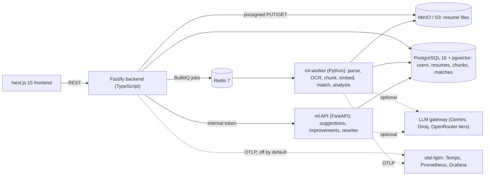

# ResuMatch AI

ResuMatch AI parses a resume the way an applicant-tracking system would, flags layout problems that
break ATS parsers, and scores how well the resume matches a job description. The match score is
explainable: hybrid retrieval (BM25 + pgvector), Reciprocal Rank Fusion and a cross-encoder reranker
pick the resume passages that matter, and a skill-gap analysis shows which requirements are covered
or missing. **Match scores come from the ML pipeline only, never from an LLM.** An optional LLM tier
writes improvement suggestions and bullet rewrites, and every rewrite is grounded against the
original resume text.

---

## Architecture



### Request lifecycle

1. **Upload.** The browser gets a presigned URL, uploads straight to S3, then calls
   `POST /v1/resumes/:id/complete`. The backend enqueues `PARSE_DOCUMENT`.
2. **Parse.** The worker extracts text (PyMuPDF / python-docx, Tesseract OCR for scans), sections,
   skills and contact details, and scores ATS hazards (multi-column, tables, header/footer text,
   missing sections). PII is redacted before anything reaches an LLM.
3. **Embed.** Section-aware chunks (≤ 240 tokens) are embedded with `all-MiniLM-L6-v2` (384-d) into
   pgvector with an HNSW index, plus a `tsvector` GIN index for BM25.
4. **Match.** For a job description: BM25 + vector retrieval, RRF fusion, `ms-marco-MiniLM-L-6-v2`
   reranking, then skill coverage. Final score = 0.65 × reranker + 0.25 × skill coverage + 0.10 × vector
   similarity. Coverage counts required skills fully and preferred skills at half weight, and
   treats "X or Y" as one requirement. Skills come from the JD form, or are read from the JD's
   "Required" / "Preferred" sections. If the JD names no recognizable skills, the coverage term is
   dropped rather than counted as 100%.
5. **Explain and improve.** The match explanation lists matched/missing skills and the top resume
   passages. Optional LLM analysis and rewrites are checked against the resume text, and fabricated
   quotes are rejected.

---

## Measured results (every number links to its source)

| Area | Result | Evidence |
| :--- | :--- | :--- |
| Match ranking, handwritten set (32 pairs, realistic JDs) | pairwise ordering accuracy **98.2%**, score-band accuracy **93.8%**, MRR **1.000**, NDCG@3 **0.996** | [ML failure analysis](docs/eval/ML_FAILURE_ANALYSIS.md) |
| Match ranking, held-out test split of a 6-field, 629-pair set | pairwise **99.6%**, band accuracy **80.2%** (was 75.8% before required/preferred skills and "or" alternatives; some strong non-tech matches still score medium) | [ML failure analysis §8](docs/eval/ML_FAILURE_ANALYSIS.md#8-round-2-sprint-trials-2026-10-28) |
| Bugs found by the ML failure analysis | long JDs crashed matching; empty required skills added 25 points to every score; the skill map had 16 entries. All fixed with regression tests | [§4](docs/eval/ML_FAILURE_ANALYSIS.md#4-failures-grouped-by-cause) |
| Model choice within the 2 GB worker budget | a larger reranker, a stronger embedder and an int8-quantized reranker (2× faster, −2.4 pts band accuracy) were measured and rejected | [§7](docs/eval/ML_FAILURE_ANALYSIS.md#7-model-trials-within-the-2-gb-worker-budget), [§8.3](docs/eval/ML_FAILURE_ANALYSIS.md#83-rejected-int8-dynamic-quantization-of-the-cross-encoder) |
| Document parsing (synthetic set) | mean CER 3.44%, WER 3.49% across DOCX, text PDF and scanned PDF | [parsing accuracy](docs/eval/parsing_accuracy.md). The 60 documents come from about 5 sources, see the analysis §2 |
| Load tests (k6, mock LLM, one laptop) | 0 failed HTTP requests out of 180,791 across the four baseline runs; read endpoints p95 28–45 ms. Under sustained load, ingestion and matching **miss** the SPEC latency targets | [performance](docs/PERFORMANCE.md), [raw results](loadtest/results/) |
| ML worker memory | peak 850 MiB at a 2 GB limit (worst-case 4.5 MB image PDF), no OOM | [performance §ML memory](docs/PERFORMANCE.md#ml-memory-spec-74) |
| Security | threat model, OWASP ASVS L2 review, findings register SEC-01 to SEC-14 | [security](docs/SECURITY.md) |

Numbers come from synthetic or auto-labeled data on a single machine. The limitations section lists
what they don't show.

---

## Quick start

Requires Docker with Compose v2.

```bash
scripts/bootstrap.sh          # Windows: .\scripts\bootstrap.ps1
```

This creates `.env` with freshly generated secrets and no LLM keys, so the stack runs LLM-off.

```bash
docker compose up --build
```

| Service | URL |
| :--- | :--- |
| Frontend | http://localhost:3000 |
| Backend API | http://localhost:4000 |
| ML API | http://localhost:8000 |
| MinIO console | http://localhost:9001 |

```bash
make health                   # or scripts/health.sh / scripts/health.ps1
```

Prints every container's health. To enable LLM features, put your own provider keys in `.env`
(see `.env.example`).

## Running tests

| Suite | Command |
| :--- | :--- |
| Backend (Vitest) | `cd backend && npm test` |
| Frontend (Vitest) | `cd frontend && npm test` |
| ML unit tests | `python -m pytest ml/tests -m "not live and not integration"` |
| ML integration tests (need the running stack) | `docker compose exec ml sh -c 'cd /workspace/ml && python -m pytest -p no:cacheprovider -m integration'` |
| ML eval and CI gate | `python -m ml.eval.run --dataset ml/eval/datasets/handwritten` and `python -m ml.eval.gate` |
| E2E smoke (stack running) | `node e2e/smoke.mjs` |
| Load tests | [`loadtest/README.md`](loadtest/README.md) |

CI (`.github/workflows/ci.yml`) runs lint (actionlint, hadolint, ruff, mypy, tsc), all of the
suites above, the eval gate, Gitleaks and Trivy, and a k6 smoke test against a mock LLM.

## Observability

Tracing is off by default. To turn it on:

```bash
OTEL_EXPORTER_OTLP_ENDPOINT=http://otel-lgtm:4318 docker compose --profile observability up --build
```

Grafana is then at http://localhost:3001. One trace follows a request from the backend through
BullMQ into the worker's retrieval and rerank stages. Spans carry no resume text, contact details,
query strings or tokens (SEC-14, with canary tests). See [observability/README.md](observability/README.md).

## Limitations

- **Evaluation data is not real hiring data.** The handwritten set is small (32 pairs), and the
  629-pair set's labels were generated by counting skill keywords, with some confirmed label errors.
  A human-labeled set is the top open item in the analysis.
- **Some strong non-tech matches still score as medium.** Required/preferred skills and "or"
  alternatives fixed part of this (band accuracy 75.8% → 80.2%). Most of the rest are resumes that
  never mention a required skill such as GAAP or tax.
- **Throughput.** On one laptop, ingestion and matching miss the SPEC latency targets under sustained
  load (serialized OCR, CPU-bound reranking). Single requests meet them. See
  [docs/PERFORMANCE.md](docs/PERFORMANCE.md).
- **Not deployed.** The Render deployment (Phase 10B Workstream C) is deferred, so there is no live
  demo.
- Tracing covers HTTP and the match pipeline. LLM token and cost metrics have a dashboard, but cost
  is an estimate: it is 0 unless `LLM_PRICES_JSON` sets prices, because every configured tier is free.

## Project docs

[Specification](docs/SPECIFICATION.md) · [Roadmap](docs/ROADMAP.md) · [Rules](docs/RULE.md) ·
[CI](docs/CI.md) · [Reliability](docs/RELIABILITY.md) · [Phase 10B plan](docs/PHASE_10B_PLAN.md)

## License

Proprietary / CBP Project - All Rights Reserved.
