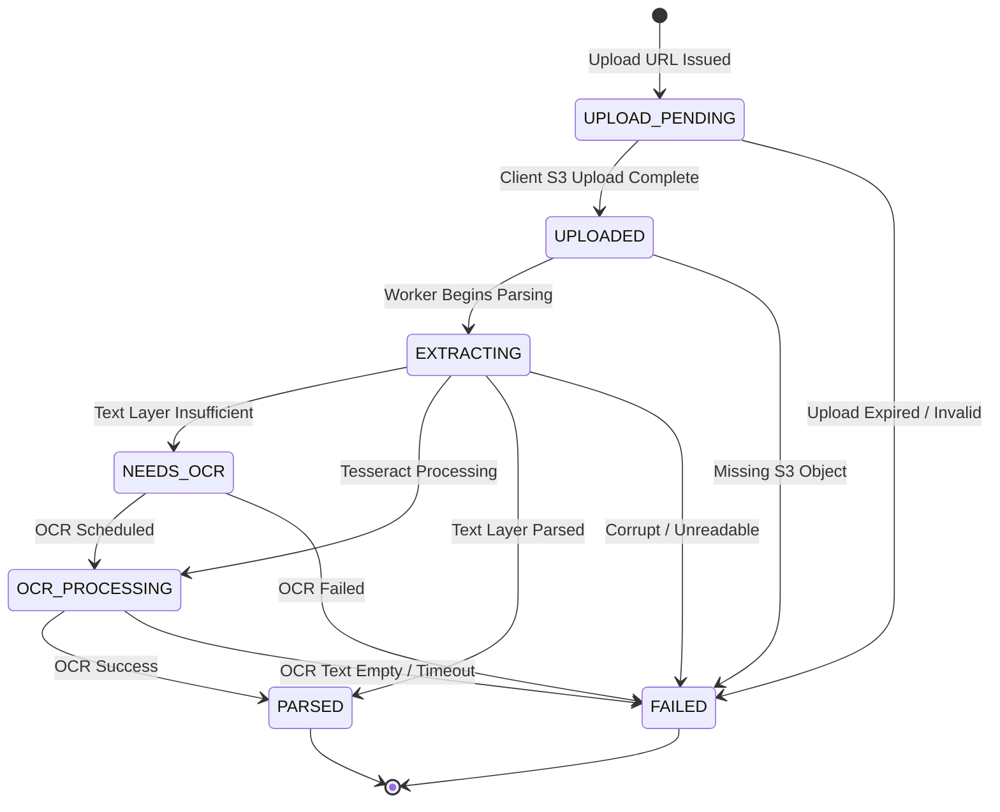
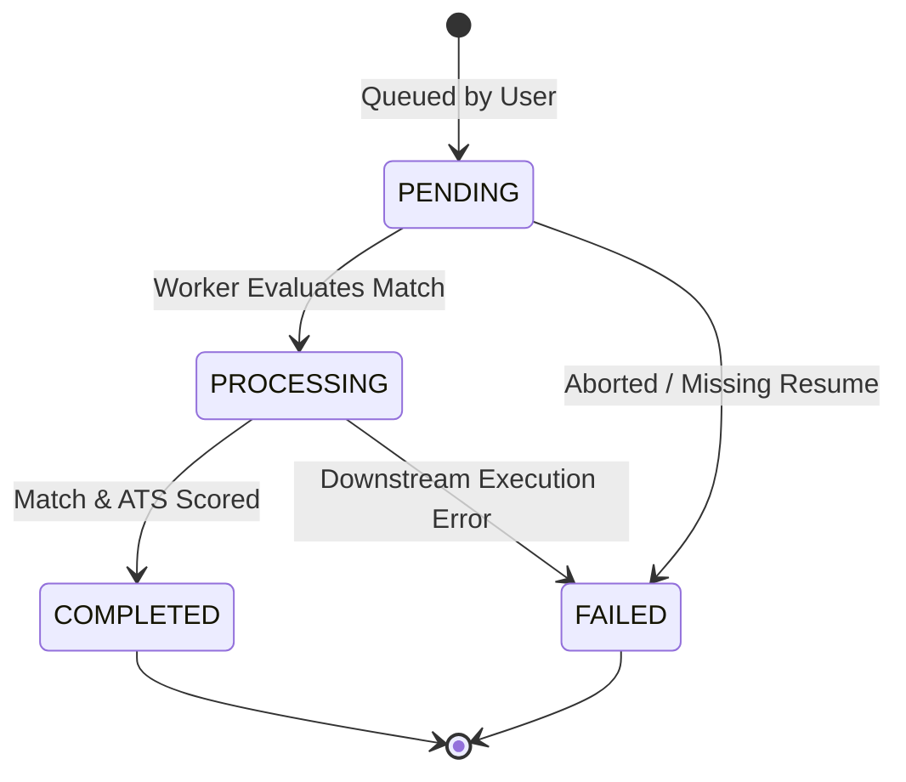

# ResuMatch AI — Reliability & Distributed Systems Architecture

## 1. BullMQ Queue Inventory & Concurrency Model

ResuMatch AI decouples CPU-heavy and asynchronous workloads using BullMQ on Redis. All jobs are strictly typed, contain zero PII in payloads, and have deterministic job IDs to guarantee idempotency.

| Queue Name | Producer | Consumer | Concurrency | Retry / Backoff | Job ID Pattern | Payload Fields (Zero PII) | DLQ Queue |
| :--- | :--- | :--- | :---: | :--- | :--- | :--- | :--- |
| **`resume-parsing-queue`** | Backend `resumes.ts` | ML Worker (`ml.worker`) | 2 | 3 attempts, exponential backoff (1s initial) | `parse-{resumeId}` | `{ resumeId, storageKey, mimeType, bucket }` | `resume-parsing-queue-dlq` |
| **`embedding-queue`** | ML Worker / Backend | ML Worker (`ml.worker`) | 2 | 3 attempts, exponential backoff (1s initial) | `embed-{resumeId}` | `{ entityType, entityId, resumeId }` | `embedding-queue-dlq` |
| **`match-scoring-queue`** | Backend `jobs.ts` | ML Worker (`ml.worker`) | 2 | 3 attempts, exponential backoff (1s initial) | `match-{resumeId}-{jobId}` | `{ resumeId, jobId }` | `match-scoring-queue-dlq` |
| **`analysis-queue`** | Backend `analyses.ts` | ML Worker (`ml.worker`) | 1 | 3 attempts, exponential backoff (1s initial) | `analysis-{resumeId}-{jobId}` | `{ resumeId, jobId }` | `analysis-queue-dlq` |
| **`cleanup-queue`** | Backend Repeatable Cron | Backend `cleanupQueue.ts` | 1 | 2 attempts, exponential backoff (5s initial) | `scheduled-24h-cleanup` | `{ trigger: "SCHEDULED", timestamp }` | `cleanup-queue-dlq` |

---

## 2. State Machines & Transition Guards

State transitions are strictly validated by central state machine guards in both backend TypeScript (`backend/src/services/stateMachines.ts`) and Python ML worker (`ml/pipelines/intake/state_machine.py`).
- Out-of-order or duplicate worker jobs attempting illegal transitions are rejected.
- Self-transitions (`from == to`) are recognized as idempotent no-ops.
- Terminal states (`PARSED`, `FAILED`, `COMPLETED`) are immutable.

### 2.1 Resume Processing Lifecycle

### 2.2 Analysis Lifecycle

---

## 3. Retry Policy & Dead Letter Queue (DLQ) Architecture

1. **Transient vs Non-Retryable Error Classification:**
   - **Non-Retryable Errors:** Parsing errors like `CorruptFileError`, `EncryptedPdfError`, `TooManyPagesError`, and `UnsupportedTypeError` bypass BullMQ retries immediately, mark the resume as `FAILED` with user-safe error messages, and avoid wasting compute.
   - **Retryable Errors:** Transient database disconnections, network blips, or storage timeouts trigger BullMQ's exponential backoff (`delay = 1000 * 2^(attempt - 1)`).
2. **Dead Letter Queues:**
   - When a job exceeds its maximum retry attempts, it is routed to `<queue-name>-dlq` via `moveToDlq`.
   - The DLQ preserves the original payload, execution metadata, error message, stack trace, and timestamps.
3. **DLQ Inspection CLI (`backend/scripts/dlqInspect.ts`):**
   - Protected by a strict localhost check (`refuse execution on non-localhost Redis`).
   - Commands:
     - `npx tsx scripts/dlqInspect.ts summary`: Lists job counts across all DLQs.
     - `npx tsx scripts/dlqInspect.ts inspect <queue-name>`: Inspects failure reasons and sanitized payloads.
     - `npx tsx scripts/dlqInspect.ts retry <queue-name> <job-id>`: Replays a dead-letter job back to the primary queue.

---

## 4. Idempotency Guarantees

1. **Deterministic BullMQ Job IDs:**
   - Enqueueing uses predictable keys (`parse-{resumeId}`, `embed-{resumeId}`). Re-queueing the same job while one is already active or completed is deduplicated by BullMQ at the Redis level.
2. **`Idempotency-Key` Header on Metered Routes:**
   - Client requests to metered POST routes (`/v1/rewriter/bullet`, `/v1/resumes/:id/improvements`, `/v1/analyses/run`) support the `Idempotency-Key` header.
   - **Redis Atomic Lock:** Acquires an in-flight distributed lock via `SET idempotency:{userId}:{key} IN_PROGRESS EX 60 NX`. Concurrent double-clicks receive `409 Conflict`.
   - **Payload Hash Validation:** Requests calculate `SHA-256(payload)`. If a key is reused with a different payload, the API returns `422 Unprocessable Entity`.
   - **Zero Double Metering:** When a completed key is replayed, the cached response is served with `X-Idempotency-Replay: true` and **zero quota units are deducted**.

---

## 5. Graceful Shutdown & Maintenance Cleanup

1. **Process Signal Handling:**
   - Backend listens on `SIGINT` and `SIGTERM`.
   - Fastify stops accepting new connections and drains in-flight requests (`await app.close()`).
   - BullMQ workers and DLQ queues drain cleanly before process exit (`stopCleanupWorker()`, `closeDlqQueues()`).
   - Database connections and Redis clients disconnect cleanly (`prisma.$disconnect()`, `redisClient.quit()`).
2. **24-Hour Maintenance Cleanup Worker:**
   - A repeatable BullMQ job (`0 * * * *`, hourly) executes `run24HourCleanup()`.
   - Purges stale uncompleted uploads (`UPLOAD_PENDING` > 24h old) from MinIO storage and PostgreSQL.
   - Cleans orphaned temporary objects without altering storage gauge counts.
