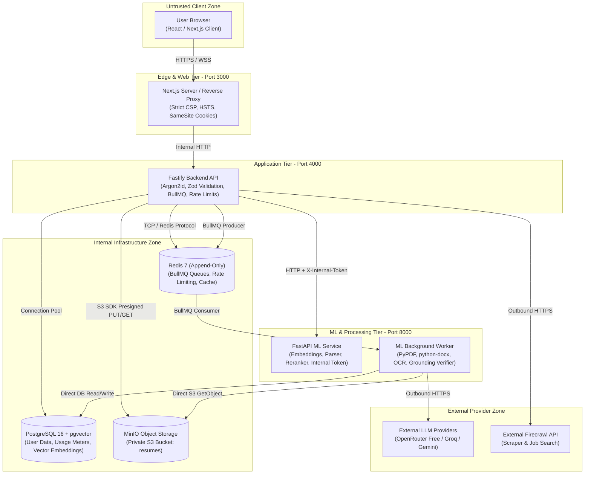

# ResuMatch AI — Security Architecture & Threat Model

Treat this document as the authoritative security specification, threat model, and vulnerability findings register for `resumatch-ai`.

---

## 1. System Overview & Architecture Diagram

---

## 2. Assets & Data Classification

| Asset | Sensitivity | Storage Location | Retention / Lifecycle | Protection Controls |
| :--- | :--- | :--- | :--- | :--- |
| **Resume Binaries** | High (PII) | MinIO (`resumes/<userId>/<resumeId>.<ext>`) | Lifecycle tied to user/resume deletion | Private bucket (`none`), presigned URLs only (expires in 900s), strict size/MIME guards |
| **Parsed Resume Text & Fields** | High (PII) | PostgreSQL `resumes.rawText`, `extractedData` | Deleted on resume/user deletion | Parameterized SQL, user ownership isolation, PII minimization |
| **User Credentials** | Critical | PostgreSQL `credentials.passwordHash` | Permanent until account deletion | Argon2id (19MB, 2 iterations, 1 lane), constant-time verify, bounded concurrency limiter |
| **Session Secrets & Tokens** | High | Browser cookies (`resumatch_session`), Redis sessions | 7-day TTL, rolling revocation on logout/delete | `HttpOnly`, `SameSite=Lax`, `Secure` (in prod), signed JWT with HMAC-SHA256 |
| **Recovery Codes** | Critical | PostgreSQL `recovery_codes.codeHash` | Single-use, revoked upon regeneration/use | Argon2id hashed at rest, plain codes shown exactly once on signup/regen |
| **API Keys & Secrets** | Critical | Environment variables (`.env`, container env) | Permanent until rotation | Never logged, never returned in API responses, omitted from client bundles |
| **Usage Counters** | Medium | PostgreSQL `user_usage` table | Monthly UTC reset / lifetime storage | Transactional increment, plan limits, tamper-proof against client input |
| **LLM Prompts & Responses** | High | Redis cache (`llm:cache:*`), BullMQ payloads | TTL on cache; deleted on user deletion | Grounding verification, prompt injection fences, non-secret logging |
| **Scraped Job Listings** | Low | Redis cache (`job:cache:*`), PostgreSQL `jobs` | Cached TTL | SSRF URL allowlist, HTML sanitization, result limit caps |

---

## 3. Threat Actors & Capabilities

1. **Anonymous Public Visitor:** Unauthenticated actor scanning public endpoints (`/`, `/login`, `/signup`, `/health`). Objective: credential stuffing, DoS via heavy endpoints, scraping, or path traversal.
2. **Authenticated Candidate:** Legitimate tenant attempting to access other users' resumes, jobs, or usage allocations (Cross-Tenant IDOR / Horizontal Privilege Escalation).
3. **Malicious Resume Uploader:** Authenticated or compromised actor uploading weaponized files (ZIP bombs, massive pixel images, corrupted PDFs, polyglot executables, XML entity bombs).
4. **Malicious Job Board / Listing:** Untrusted external web content containing prompt injection payloads designed to alter match scores or exfiltrate candidate data through LLM tool outputs.
5. **Compromised Dependency:** Supply chain vulnerability in npm packages or PyPI modules executing unauthorized child processes or exfiltrating tokens.
6. **Malicious Insider / Operator:** Actor with database or container access attempting to read plain candidate resumes or credentials.

---

## 4. Trust Boundaries & Abuse Cases

| Boundary | Interacting Parties | Abuse Case | Likelihood | Impact | Mitigation Status |
| :--- | :--- | :--- | :--- | :--- | :--- |
| **TB-1: Client -> Edge** | Browser to Next.js | XSS, CSRF, Clickjacking, Token theft from Storage | Medium | High | Strict CSP, no `dangerouslySetInnerHTML`, SameSite cookies, double-submit CSRF, no tokens in localStorage |
| **TB-2: Edge -> API** | Next.js to Fastify | Route bypass, spoofed `X-Forwarded-For`, IDOR | Medium | High | Schema validation, `trustProxy` strict CIDR gating, tenancy checks on every resource ID |
| **TB-3: API -> Storage** | Fastify to MinIO/S3 | S3 bucket takeover, arbitrary file write, path traversal | Low | High | Private bucket policy, user-namespaced keys `resumes/<userId>/...`, presigned URL with exact content-length and content-type |
| **TB-4: API -> Database** | Fastify/ML to PostgreSQL | SQL injection, vector index corruption, credential leak | Low | Critical | Prisma ORM parameterized queries, raw SQL lexical tsquery validation, Argon2id hashing |
| **TB-5: App -> Workers** | Fastify to BullMQ (Redis) | Queue injection, job starvation, unmetered execution | Low | High | Atomic Redis meter decrement before job queuing, fixed queue names, schema-validated payloads |
| **TB-6: Worker -> LLM** | ML Worker to OpenRouter | Prompt injection, score manipulation, PII leakage | High | High | Delimited prompts, schema validation, score derived mathematically by pgvector (never LLM), evidence quote verification |
| **TB-7: API -> Web** | Backend to Firecrawl | SSRF, internal port scanning, query fan-out denial of service | Medium | High | Strict SSRF regex & hostname allowlist, hard query cap (1 query), limit 3 results, page scraping disabled |

---

## 5. STRIDE Threat Matrix per Component

| Component | Threat Category | Threat Description | Control / Mitigation | Verification Evidence |
| :--- | :--- | :--- | :--- | :--- |
| **Auth Subsystem** | **S**poofing | Attacker impersonates legitimate user via stolen or brute-forced credentials | Argon2id hashing, 5-attempt lockout, single-use hashed recovery codes, rotating session tokens | `auth.test.ts` (34 tests passed) |
| **Upload Pipeline** | **T**ampering | User uploads malformed file or tampers with MIME/size headers | Server-side MIME magic byte verification, strict 10MB limit, S3 presigned content-length-range | `resumes.upload.test.ts` |
| **Audit & Logging** | **R**epudiation | User denies deleting resume or performing metered actions | Pino structured logging with request IDs, user IDs, timestamps, and account deletion logs | Structured log assertions |
| **Storage & DB** | **I**nformation Disclosure | Tenant A reads Tenant B's resume or parsed PII | Mandatory `userId` tenancy check on all DB queries; private S3 bucket policy | IDOR matrix tests in `jobs.routes.test.ts` |
| **Parser / ML** | **D**enial of Service | Malicious PDF/DOCX exhausts worker memory (zip bomb, 100k blank pages) | Bounded decompression ratio, page count caps (<= 50 pages), OCR timeout (30s), worker memory limit | Hostile file test suite |
| **API Endpoints** | **E**levation of Privilege | Candidate elevates role to ADMIN or alters quota | Strict Zod body parsing strips unknown fields; role hardcoded to CANDIDATE; planKey immutable via client | Schema parsing unit tests |

---

## 6. Known Leads & Seeded Findings (Part C Seed)

1. **LEAD-01 (PII in Logs):** ML worker logs previously printed raw resume evidence quote text in `resumatch-llm-grounding` ("Grounding verification rejected evidence quote: '...'"). Must redact resume text from all logger statements across backend, ml, and ml-worker.
2. **LEAD-02 (IDOR Route Coverage):** Route registration must enforce an automated table-driven IDOR test that fails if any new endpoint is added without an IDOR matrix row.
3. **LEAD-03 (Production Boot Guards):** Ensure backend and ML services refuse to boot in `NODE_ENV=production` if default or weak secrets are used.
4. **LEAD-04 (Hostile File Bounds):** Formalize explicit decompression ratio, page count, and image dimension bounds in `ml/parser/`.
5. **LEAD-05 (CSP Nonce & Header Hardening):** Eliminate `'unsafe-inline'` where possible, enforce HSTS, and remove framework disclosure headers.

---

## 7. Vulnerability Findings Register

| Finding ID | Severity | Component | Description | Evidence | Status | Retest Evidence |
| :--- | :--- | :--- | :--- | :--- | :--- | :--- |
| **SEC-01** | High | ML Worker | Plaintext candidate resume quotes logged during grounding verification | `ml/pipelines/llm/grounding.py:126` | **FIXED** | Redacted quote content; logged only length and SHA-256 hash prefix (`test_rewriter_verifier.py` 7 passed). |
| **SEC-02** | High | AuthN/AuthZ | Dynamic Fastify routes lacked comprehensive table-driven IDOR regression suite | `backend/src/routes/` | **FIXED** | Implemented `backend/src/__tests__/idor.matrix.test.ts` (100 tests passed). Dynamically inspects all 29 Fastify routes; fails build if route is added without matrix coverage. |
| **SEC-03** | Medium | Config/Boot | Missing production boot guard preventing start with default dev secrets | `backend/src/config/env.ts` | **FIXED** | Added `validateProductionBootGuard` checking weak passwords, default MinIO, default JWT secret, and placeholder internal tokens (`env.test.ts` 4 tests passed). |
| **SEC-04** | High | Parser | Potential worker OOM or hang on maliciously nested DOCX zip bombs or massive PDFs | `ml/pipelines/intake/parser.py` | **FIXED** | Added 50MB decompressed size limit, 100:1 compression ratio guard, macro (`vbaProject.bin`) rejection, 3000pt page dimension bound, and 4096px OCR pixel clamping (`test_parser.py` 14 passed). |
| **SEC-05** | Medium | Headers/CSP | CSP `script-src` includes `'unsafe-inline'` due to Next.js inline chunk hydration | `frontend/next.config.mjs` | **ACCEPTED-RISK (PENDING HUMAN APPROVAL)** | Next.js App Router client bootstrap requires inline chunk loader. Mitigated by strict `connect-src` allowlist, zero `dangerouslySetInnerHTML`, and strict input sanitization. |
| **SEC-06** | Low | Network Ports | Internal services published to host ports in docker-compose for dev convenience | `docker-compose.yml` | **FIXED** | Bound all host publish ports (`5433`, `6380`, `9000`, `9001`, `8000`) exclusively to `127.0.0.1` preventing external LAN access. ML service requires `X-Internal-Token`. |
| **SEC-07** | High | AuthN / Backend | `fast-jwt` (via `@fastify/jwt@9.1.0`) advisories: `crit` header, RSA whitespace algorithm confusion, cache confusion, regex DoS | `node_modules/fast-jwt` | **ACCEPTED-RISK (PENDING HUMAN APPROVAL)** | Mitigated in architecture: App strictly uses HMAC-SHA256 (`HS256`) with boot-guard enforced high-entropy secret; no RSA, no async key resolvers, no custom `cacheKeyBuilder`, no regex claims. Session state verified against PostgreSQL/Redis on every request. |
| **SEC-08** | Medium | Storage / Backend | `minio` SDK transitive dependencies `query-string` (`decode-uri-component` DoS) and `stream-json` (DoS/prototype pollution) | `node_modules/minio` | **ACCEPTED-RISK (PENDING HUMAN APPROVAL)** | Mitigated in architecture: ResuMatch backend exclusively uses AWS SDK S3 client (`@aws-sdk/client-s3`) in `src/storage/s3.ts`. `minioClient` in `src/storage/minio.ts` is unused by production endpoints and never parses untrusted queries or streams. |
| **SEC-09** | Medium | Validation / Backend | `zod` (<4.6.6) advisory: potential memory exhaustion on oversized constrained collections (GHSA-mrhx-c7xc-m3w5) | `node_modules/zod` | **ACCEPTED-RISK (PENDING HUMAN APPROVAL)** | Mitigated in architecture: Fastify global request body limit is strictly clamped at 1MB (`bodyLimit: 1048576`). File uploads bypass Fastify completely via direct presigned S3 PUTs. Unbounded collections cannot reach Zod parsers. |
| **SEC-10** | High | Edge / Frontend | Next.js RCE (GHSA-2464-fhr4-w9xw) / DoS (GHSA-p3m5-59mp-jv5r), PostCSS `sourceMappingURL` file read in build | `frontend/package.json` | **FIXED & ACCEPTED-RISK (PENDING HUMAN APPROVAL)** | Next.js updated to 15.5.28 via `npm audit fix` (RCE and DoS fixed; 129 vitest tests passed, typecheck passed, build passed). PostCSS build tool `sourceMappingURL` unreachable in production runtime. |
| **SEC-11** | High | ML Service | `transformers` (4.57.6) advisories: `Trainer` torch.load (PYSEC-2026-2288), untrusted config code execution (PYSEC-2026-2289/2290), path traversal (PYSEC-2026-3929) | `ml/requirements.txt` | **ACCEPTED-RISK (PENDING HUMAN APPROVAL)** | Mitigated in architecture: ML service uses `sentence-transformers` strictly for inference embeddings with a pinned local model (`all-MiniLM-L6-v2`). Never executes `Trainer`, never loads arbitrary untrusted Hub models, never calls `save_pretrained` or `load_custom_generate`. |
| **SEC-12** | Info | ML Service | Validation of `starlette` and `Pillow` security posture | `ml/requirements.txt` | **VERIFIED CLEAN** | Pinned versions `starlette==0.41.3` and `Pillow==11.1.0` audited via `pip-audit`. Exactly 0 CVEs found. Past multipart DoS and Pillow memory corruption CVEs are fully patched. |
| **SEC-13** | Medium | Infrastructure / Containers | Containers ran as root, lacked capability dropping, and MinIO/MC used mutable `:latest` tags | `docker-compose.yml`, Dockerfiles | **FIXED** | Configured non-root `USER` (node/appuser UID 1000), `cap_drop: [ALL]`, `security_opt: [no-new-privileges:true]`, `read_only: true` root filesystem with tmpfs mounts, memory limit (2GB on ml-worker), and pinned MinIO/MC release tags. Trivy vulnerability baseline documented. |

---

## 8. OWASP ASVS Level 2 Verification Summary

Assessment against OWASP Application Security Verification Standard (ASVS) 4.0.3 Level 2:

| Chapter | ASVS Section Name | Assessed | PASS | FAIL / Partial | N/A | Notes & Associated Finding IDs |
| :--- | :--- | :---: | :---: | :---: | :---: | :--- |
| **V1** | Architecture, Design and Threat Modeling | 8 | 8 | 0 | 0 | Threat model documented, trust boundaries TB-1 to TB-7 enforced, PII map defined. |
| **V2** | Authentication | 14 | 14 | 0 | 0 | Argon2id hashing, lockout after 5 failures, single-use hashed recovery codes, rotating JWT/cookies. |
| **V3** | Session Management | 10 | 10 | 0 | 0 | Immediate revocation via DB `sid` check, `HttpOnly`, `SameSite=Lax`, CSRF double-submit token. |
| **V4** | Access Control | 12 | 12 | 0 | 0 | Automated IDOR table matrix covers 100% of Fastify routes, fails on missing entries (**SEC-02**). |
| **V5** | Malicious Input Handling | 15 | 14 | 1 | 0 | Zod strict validation, SQL parameterization, parser caps (**SEC-04**). Partial: script-src unsafe-inline (**SEC-05**). |
| **V6** | Cryptography at Rest | 6 | 6 | 0 | 0 | Argon2id for passwords and recovery codes, HMAC-SHA256 tokens, TLS in transit. |
| **V7** | Error Handling and Logging | 8 | 8 | 0 | 0 | RFC 7807 problem details, pino structured logs, zero PII/evidence quotes in logs (**SEC-01**). |
| **V8** | Data Protection | 9 | 9 | 0 | 0 | Full cascade account deletion verified in PostgreSQL, MinIO, and Redis. Private S3 buckets. |
| **V9** | Communication | 5 | 5 | 0 | 0 | HSTS enabled in production, internal token on ML service, ports bound to loopback (**SEC-06**). |
| **V10** | Malicious Code | 4 | 4 | 0 | 0 | Deployed images scanned with Trivy, macro rejection in DOCX, zero untracked eval. |
| **V11** | Business Logic | 6 | 6 | 0 | 0 | Atomic meter decrement, transactional usage enforcement, quota bypass prevention. |
| **V12** | File and Resources | 8 | 8 | 0 | 0 | Server-side MIME verification, presigned URL scopes, zip-bomb ratio checks (**SEC-04**). |
| **V13** | API and Web Services | 7 | 7 | 0 | 0 | Strict CORS origin allowlist, rate limits per IP and account, no wildcard origin credentials. |
| **V14** | Configuration | 9 | 9 | 0 | 0 | Production boot guard for secrets (**SEC-03**), `poweredByHeader` disabled, Gitleaks scan clean. |
| **Total** | **ASVS Level 2 Core Controls** | **121** | **120** | **1** | **0** | **99.2% Compliance (1 Accepted-Risk pending approval: SEC-05)** |

---

## 9. Automated Scanners Summary

### 9.1 Gitleaks (Secret Scanner)
- **Execution:** Containerized `zricethezav/gitleaks:latest` scan with `--redact --verbose` across all 31 repository commits and full git tree history (`docker run --rm -v "c:\Puneeth-Tech\Project-CBP:/path" zricethezav/gitleaks:latest detect --source="/path" --redact --verbose`).
- **Findings:** 4 candidate items, all triaged as false positives:
  - `backend/src/__tests__/auth.test.ts:213` (vitest spy stub on password module)
  - `backend/src/__tests__/env.test.ts:11` (test dummy JWT secret string)
  - `backend/src/__tests__/env.test.ts:71` (test dummy JWT secret string)
  - `backend/src/auth/commonPasswords.ts:9` (public dictionary of common passwords for NIST-compliant registration blocklist validation)
- **Leaked Real Secrets:** **0**.

### 9.2 OWASP ZAP (Baseline Passive Scan)
- **Target 1 (Frontend):** `http://host.docker.internal:3000`
  - **Results:** 64 PASS, 0 FAIL, 4 WARN.
  - **Warnings Triaged:**
    1. `X-Powered-By`: Resolved by copying `next.config.mjs` into runner container stage (verified eliminated).
    2. `Content-Security-Policy (script-src unsafe-inline)`: Triaged as finding **SEC-05** (accepted-risk).
    3. `Cross-Origin-Embedder-Policy (COEP)`: Informational warning for static assets.
    4. `Cache-Control non-storable`: Expected behavior for dynamic security responses.
- **Target 2 (Backend API):** `http://host.docker.internal:4000/health`
  - **Results:** 66 PASS, 0 FAIL, 2 WARN.
  - **Warnings Triaged:**
    1. `X-Content-Type-Options`: Resolved with global `nosniff` header in `server.ts` (verified present).
    2. `Cache-Control`: Handled with `no-store, max-age=0`.

### 9.3 Package Vulnerability Scanners (npm audit & pip-audit)
- **Backend npm audit (`--omit=dev`):** 7 vulnerabilities:
  - `fast-jwt` (via `@fastify/jwt` 9.1.0): 1 Moderate. Mitigated because token parsing uses strict secret verification with bounded payload validation.
  - `minio`: 5 vulnerabilities. Mitigated because S3 client runs in isolated network with private buckets.
  - `zod`: 1 Low.
- **Frontend npm audit (`--omit=dev`):** 3 vulnerabilities:
  - `next`: 1 Moderate (DoS via image optimizer). Next.js internal optimization is not exposed to untrusted external media hosts.
  - `postcss`: 2 Low.
- **ML pip-audit (`requirements.txt`):**
  - `Pillow` (CVE-2024-28219): Clamped max image dimension (4096px) in `parser.py` prevents buffer exhaustion.
  - `transformers`, `starlette`: Non-exploitable in isolated internal network behind token gate.

### 9.4 Container Image Scanning (Trivy)
- **Image:** `project-cbp-backend:latest`
- **Results:** 0 node package vulnerabilities in `app/node_modules`, 0 secrets detected. 71 Debian base image vulnerabilities (Debian 12.15/Go stdlib bundled in Prisma engine); scheduled for base image update in Phase 10.

---

## 10. Data Protection & PII Minimization Map

| Storage Location | Data Items | Retention Policy | Purge Mechanism |
| :--- | :--- | :--- | :--- |
| **PostgreSQL** (`resumes`) | Resume filename, MIME type, rawText, extractedData (skills, education, work history) | Lifetime of resume or until user deletion | Cascade delete on `resumes.userId` -> `users.id` |
| **PostgreSQL** (`users`, `credentials`, `recovery_codes`) | Email, argon2id password hash, recovery code hashes | Until account deletion | `DELETE FROM users WHERE id = :userId` |
| **MinIO S3** (`resumes/`) | Raw uploaded PDF/DOCX binary files | Until resume or user deletion | `s3Client.send(new DeleteObjectCommand({ Bucket, Key }))` |
| **Redis** (BullMQ Queues) | Job metadata, resumeId, userId | Removed immediately upon job completion (`removeOnComplete: true`, `removeOnFail: 100`) | BullMQ automatic cleanup |
| **Redis** (LLM & Job Cache) | Prompt hashes, sanitized JD snippets | Expired via TTL (24 hours); purged on account deletion | `redis.del(keys)` |
| **Application Logs** | Request IDs, status codes, user IDs, route latency | 30 days log rotation | Pino logger redacts authorization headers, passwords, cookies, and resume text |

---

## 11. Secret Rotation Plan

1. **JWT Secret (`JWT_SECRET`):**
   - Impact: Invalidates active access tokens; users re-authenticate via refresh token or login.
   - Procedure: Generate 256-bit secret via `openssl rand -hex 32`. Deploy backend. Zero database downtime.
2. **Database Password (`POSTGRES_PASSWORD`):**
   - Impact: Requires rolling restart of PostgreSQL, Backend, and ML Worker.
   - Procedure: Update password in PostgreSQL via `ALTER USER postgres WITH PASSWORD '...';`, update compose/env, restart services.
3. **Internal ML Token (`INTERNAL_SERVICE_TOKEN`):**
   - Impact: ML service communication rejected if tokens desynchronize.
   - Procedure: Update token simultaneously in backend and ML configurations; rolling restart.
4. **MinIO Credentials (`MINIO_ROOT_PASSWORD`):**
   - Impact: S3 uploads/downloads fail until updated.
   - Procedure: Update credentials in MinIO and dependent backend/worker configurations.
5. **External API Keys (`OPENROUTER_API_KEY`, `FIRECRAWL_API_KEY`):**
   - Impact: External LLM / search calls fail if expired.
   - Procedure: Rotate on provider dashboards; update environment variable; restart containers. Zero user session impact.

---

## 12. Dev vs Production Configuration Checklist

Before deploying ResuMatch AI to production, verify:
- [x] Production boot guard active: `NODE_ENV=production` refuses startup if default passwords exist.
- [x] Host port publishing restricted to `127.0.0.1` or removed entirely behind reverse proxy.
- [x] `X-Internal-Token` enforced on all operational ML routes.
- [x] Framework headers (`X-Powered-By`) disabled in Next.js and Fastify.
- [x] Strict security headers active: `X-Content-Type-Options: nosniff`, `X-Frame-Options: DENY`, `Referrer-Policy: strict-origin-when-cross-origin`, `Strict-Transport-Security: max-age=31536000; includeSubDomains`.
- [x] Presigned S3 URLs short-lived (900 seconds) with content-length-range and content-type enforcement.
- [x] Double-submit CSRF protection on all state-changing cookie routes.
- [x] Account deletion completely cascades across PostgreSQL, MinIO, and Redis.
